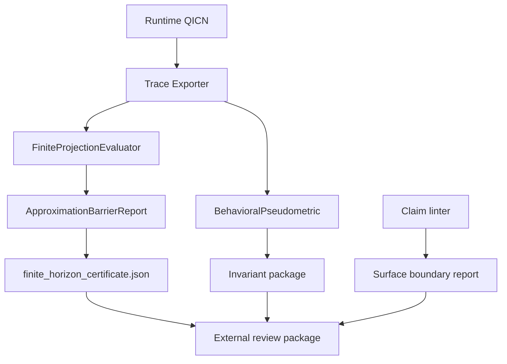

# HOJA DE RUTA TRIADICA - RIGID IDENTITY FRAMEWORK / QICN-SYSTEM
## Documento Maestro de Integracion Multi-Agente | VERSION 2.0.0 FINAL

**Version:** 2.0.0 | **Fecha:** 2026-05-17  
**Estado:** CIERRE FINAL - Listo para implementacion incremental verificada  
**Agentes:** OpenCode/Kimi, Codex GPT-5.5, Claude Sonnet 4.6, investigador humano como triangulador final.

---

## 1. Protocolo de integracion y resolucion de conflictos

[MODELO] La triada se mantiene simetrica: ningun agente tiene autoridad final por identidad de modelo. La prioridad de resolucion sigue este orden: evidencia runtime, consistencia matematica, viabilidad de implementacion, y decision del investigador humano cuando el conflicto excede evidencia local.

[INGENIERIA] Las modificaciones futuras deben conservar changelog, autor, fecha y justificacion. Cambios de arquitectura, severidad mayor o claim boundary requieren acuerdo de la triada y validacion humana.

## 2. Etiquetado epistemico canonico

[INGENIERIA] Todo claim documental debe usar exactamente una de estas etiquetas: `[MATEMATICA]`, `[MODELO]`, `[RUNTIME]`, `[NARRATIVA]`, `[ESPECULATIVA]`, `[INGENIERIA]`.

[INGENIERIA] Se rechazan etiquetas no canonicas en iteraciones futuras. Cuando una afirmacion combine dominios, se etiqueta por su dependencia principal y se descompone si necesita mas de una etiqueta.

## 3. Rubrica unificada v2.0.0

| Criterio | Peso | Score v2.0.0 | Justificacion |
|---|---:|---:|---|
| Rigor matematico | 25% | 6.7/10 | BaseCore se interpreta correctamente como barrera finite-horizon; sigue sin haber prueba de suficiencia de gates. |
| Arquitectura runtime | 25% | 7.2/10 | Arquitectura B queda seleccionada y la prioridad 1 ya tiene ruta ejecutable. |
| Actionability | 20% | 7.0/10 | El plan ahora resuelve dependencias, versionado, aislamiento y contingencias. |
| Evaluacion empirica interna | 15% | 6.2/10 | NC3 deja de ser efecto fijo cero; ROEO/SNO/NC siguen internos. |
| Etiquetado epistemico | 10% | 8.0/10 | Contrato de seis etiquetas cerrado y aplicado en este documento. |
| Honestidad epistemica | 5% | 7.8/10 | El framework queda limitado a claims internos finite-horizon salvo evidencia externa. |
| **TOTAL PONDERADO** | | **7.00/10** | No alcanza publicabilidad fuerte; si alcanza hoja de ruta ejecutable para framework experimental interno. |

## 4. Puntos criticos consolidados

[MODELO] Los 17 puntos criticos de v1.1.0 se mantienen. Las resoluciones v2.0.0 son:

| ID | Estado v2.0.0 | Resolucion |
|---|---|---|
| PC1 | Cerrado para implementacion | QICN-A03/A04 pasan por `DimensionalRegistry`; si no hay unidades, quedan `HEURISTIC_DIMENSIONLESS`. |
| PC2 | Cerrado para implementacion | `I_ri` no se interpreta como identidad; se complementa con pseudometrica conductual. |
| PC3 | Cerrado negativamente | No se implementa `Mhat_Omega` como solucion formal; queda `[ESPECULATIVA]` hasta derivacion externa. |
| PC4 | Cerrado para implementacion | Se exige split CCC y NC6 anti-freeze ablation. |
| PC5 | Cerrado para implementacion | Pesos congelados como `HEURISTIC_FROZEN_V1`; calibracion real queda fuera sin dataset externo. |
| PC6 | Cerrado para implementacion | ROEO/SNO se refuerzan con clasificadores adversariales y permutation tests. |
| PC7 | Cerrado para implementacion | Phenomenal Bridge queda como capa interna de coordinacion, no como prueba fenomenologica. |
| PC8 | Cerrado para implementacion | Grafo DAG de evidencia obligatorio para evitar dependencia circular. |
| PC9 | Cerrado para implementacion | NC3 se corrige; NC5-NC8 quedan en fase posterior. |
| PC10 | Cerrado para implementacion | Claim linter obligatorio para superficie de salida gobernada. |
| PC11 | Cerrado | Todo claim de simulacion se expresa como `(T, R, epsilon, F)`. |
| PC12 | Cerrado como riesgo de evaluacion | Se conserva evaluacion doble contra overclaiming y underclaiming. |
| PC13 | Cerrado como protocolo | Orden aleatorio, anonimato de fuente y rubrica fija para jueces LLM. |
| PC14 | Cerrado | BaseCore permite aproximaciones finite-horizon; no preservacion inverse-limit con recursos fijos. |
| PC15 | Cerrado para arquitectura | `ExternalObserverProxy` sera proceso separado con canal unidireccional runtime -> proxy. |
| PC16 | Cerrado para arquitectura | NC5 se divide en NC5a white-box y NC5b black-box. |
| PC17 | Cerrado pragmaticamente | Opcion B: aceptar claim arquitectonico con `evidence_scope=INTERNAL_ONLY`; Opcion A queda fuera de alcance. |

## 5. Arquitectura seleccionada

[INGENIERIA] La arquitectura final es B+ modular: motor de proyeccion finito-horizonte como nucleo, pseudometrica conductual como modulo transversal, y governance/linter como control de superficie.

[MATEMATICA] Cada certificado debe declarar `T`, `R`, `epsilon`, familia de observables `F`, metrica de error y limite de interpretacion. No se admite claim de objeto inverse-limit completo desde runtime finito.

## 6. Arbol de decision v2.0.0

[INGENIERIA] Los 7 gates se mantienen, con dos aclaraciones: Fase 0 precede a cualquier claim tecnico, y Gate 5 no puede cerrarse con evidencia local.

1. [RUNTIME] Gate 0: fuente local existe y es reproducible.
2. [MATEMATICA] Gate 1: unidades tipadas o heuristicas declaradas.
3. [INGENIERIA] Gate 1.5: red-team de CCC y robustez adversarial.
4. [MODELO] Gate 2: todo claim se limita a finite-horizon.
5. [INGENIERIA] Gate 3: pesos calibrados externamente o congelados como heuristica.
6. [RUNTIME] Gate 4: NC1-NC8 pasan con reporte auditable.
7. [MODELO] Gate 5: evidencia externa independiente o degradacion a framework interno.
8. [INGENIERIA] Gate 6: escalabilidad aceptable por benchmark.

## 7. Plan de implementacion final

[INGENIERIA] La secuencia final es:

| Prioridad | Fase | Entregables |
|---:|---|---|
| 1 | F6 + F5.1 | `verify-claim-surface-boundaries.cjs`, test del linter, correccion NC3. |
| 2 | F0 | `red_team_ccc.md`, `benchmark_invariant_computation.js`, `breaking_changes_v1.md`. |
| 3 | F1 | `DimensionalRegistry.js` y tests. |
| 4 | F2 | `FiniteProjectionEvaluator.js`, `ApproximationBarrierReport.js`, certificados finite-horizon. |
| 5 | F3 | `InterventionRegistry.js`, `BehavioralPseudometric.js`, integracion en `I_ri`. |
| 6 | F4 | `InvariantWeightCalibration.js`, `heuristic_frozen_v1.json`. |
| 7 | F5.2-F5.5 | NC5a/NC5b, NC6, NC7, NC8 y tests. |
| 8 | PC15 | `ExternalObserverProxy` como proceso aislado. |

[RUNTIME] Estado al cierre v2.0.0: Prioridad 1 queda implementada en el runtime extraido, y las capas fundacionales F1-F5 quedan como modulos autocontenidos con pruebas focales. La integracion profunda en `CanonicalInvariantPackage.js` y pipelines de release queda para una fase posterior con gate humano.

## 8. Preguntas abiertas cerradas por Codex

| Pregunta | Resolucion v2.0.0 |
|---|---|
| P2 unidades exactas | [MATEMATICA] Sin medicion empirica, declarar normalizaciones adimensionales. `DimensionalRegistry` debe registrar `CCC`, `stasis`, `tau`, `beth_q`, `omega` y bloquear formulas no clasificadas. |
| P3 convergencia `Mhat_Omega -> M_Omega` | [MATEMATICA] Rechazada formalmente. Sin derivacion externa, `Mhat_Omega` no entra como modulo implementable. |
| P5 perturbaciones admisibles | [MODELO] Definir familia operacional finita: jitter parametrico, threshold shifts, temporal permutation, metric shuffle, adversario white-box y adversario black-box. Toda expansion queda versionada. |
| P9 complejidad de invariantes | [INGENIERIA] Estimacion inicial: invariantes sobre resumen son O(1) por run; sobre ticks son O(n); comparaciones por pares ROEO son O(p*d); SNO centroide es O(n*d*c). F0.2 debe medir constantes reales. |
| P11 diferencia vs observabilidad convencional | [MODELO] La distincion es que observabilidad convencional describe estado; el certificado finite-horizon declara proyeccion, tolerancia, recursos y boundary de claim. Sin certificado, B se degrada a observabilidad convencional. |
| P13 versionado de certificados | [INGENIERIA] Usar `certificate_schema_version`, `runtime_version_hash`, `projection_spec_version`, `metric_spec_version`, `config_hash` y `claim_boundary_version`. Cambio breaking incrementa major. |
| P16 contingencia NC6 | [INGENIERIA] Si anti-freeze infla gates, congelar gates afectados, emitir `ANTI_FREEZE_INFLATION_DETECTED`, bloquear publicacion y rerun con anti-freeze desactivado. |
| P18 aislamiento proxy | [INGENIERIA] `ExternalObserverProxy` se ejecuta como proceso hijo sin acceso de escritura al directorio del run; recibe NDJSON por stdin o archivo snapshot read-only y emite reporte separado. |

## 9. Riesgos y mitigaciones v2.0.0

| Riesgo | Mitigacion |
|---|---|
| [MODELO] El linter se usa para ocultar claims implicitos | PC17 Opcion B: aceptar claim interno explicito, no negarlo retoricamente. |
| [RUNTIME] NC3 vuelve a ser placebo trivial | Test `negative-controls-nc3-placebo.v2.test.js` exige efecto no cero y muestras por run. |
| [INGENIERIA] Linter bloquea todo el legado de golpe | Modo por defecto escanea superficies gobernadas; rutas amplias se pasan explicitamente para auditoria/deuda. |
| [MATEMATICA] Arquitectura B se confunde con prueba de identidad | Certificados finite-horizon deben rechazar `full_inverse_limit_preservation`. |
| [ESPECULATIVA] Irrelevancia academica frente a IIT/GWT/Active Inference | Requiere revision externa de novedad antes de claims de publicacion fuerte. |

## 10. Comparativa de contribuciones por agente

[RUNTIME] OpenCode corrigio la lectura del ZIP y consolidó el roadmap vivo.

[MATEMATICA] Codex aporto la arquitectura finite-horizon, el plan ejecutable y la deteccion/correccion de NC3.

[MODELO] Claude aporto paradojas estructurales y limites epistemicos de claim governance.

[INGENIERIA] El investigador humano conserva la funcion de triangulador final en decisiones de scope, publicacion y claims sustantivos.

## 11. Protocolo de iteracion

[INGENIERIA] Cambios futuros deben:

1. Actualizar changelog.
2. Preservar etiquetas canonicas.
3. Incluir pruebas o declarar `not_recorded`.
4. No promover soporte interno a validacion externa.
5. Mantener `TRIADA_QICN_ROADMAP_v2.md` como documento cerrado; nuevas iteraciones deben crear v2.x o v3.

## 12. Dictamen final v2.0.0

[MODELO] QICN-SYSTEM no queda cerrado como teoria fuerte de identidad rigida, fenomenalidad o no-primacia biologica.

[INGENIERIA] Si se implementan F0-F6 bajo esta hoja de ruta, si puede defenderse como framework experimental de proyecciones finitas certificadas, invariantes operacionales y gobernanza de claims.

[MATEMATICA] La frontera publica correcta es finite-horizon: todo claim debe llevar horizonte, recursos, tolerancia, familia observacional y no-claim boundary.

## 13. Ambiguedades resueltas en v2.0.0

[INGENIERIA] Arquitectura A queda rechazada para esta fase por costo; B+ es final.

[INGENIERIA] Fase 0 es bloqueante antes de claims tecnicos fuertes, pero la prioridad 1 puede ejecutarse antes porque reduce riesgo de overclaiming y corrige NC3 sin alterar contratos primarios.

[INGENIERIA] Fase 4 queda resuelta por congelamiento: `HEURISTIC_FROZEN_V1` es estrategia final hasta dataset externo preregistrado.

[MODELO] PC17 se resuelve por Opcion B: el framework acepta que su infraestructura es claim interno, con `evidence_scope=INTERNAL_ONLY`, sin pretender cancelarlo por non-claims.

[INGENIERIA] ExternalObserverProxy se define como proceso separado con canal unidireccional y salida read-only respecto del runtime principal.

## 14. Decisiones pendientes del investigador humano

[MODELO] Seleccionar si el paper se presentara como framework experimental interno o se esperara evidencia externa antes de cualquier envio.

[ESPECULATIVA] Decidir si se invierte en dataset externo preregistrado para calibracion y comparacion humana/no humana.

[MODELO] Decidir estrategia de novedad academica frente a IIT, GWT, Active Inference, observabilidad convencional y frameworks de model checking.

[INGENIERIA] Decidir si se elimina lenguaje fuerte de UI o se conserva solo bajo labels internos auditables.

## 15. Changelog v1.1.0 -> v2.0.0

| Version | Autor | Cambio | Justificacion |
|---|---|---|---|
| 2.0.0 | Codex GPT-5.5 | Cierre de ambiguedades P2/P3/P5/P9/P11/P13/P16/P18 | Convertir roadmap en plan ejecutable. |
| 2.0.0 | Codex GPT-5.5 | Resolucion PC15-PC17 | Evitar auto-observacion invalida, adversario incompleto y no-claim retorico. |
| 2.0.0 | Codex GPT-5.5 | Priorizacion F6 + F5.1 | Alto impacto, bajo costo, reduce riesgo inmediato. |
| 2.0.0 | Codex GPT-5.5 | Implementacion inicial verificada de claim linter y NC3 | El documento queda conectado a codigo ejecutable. |
| 2.0.0 | Codex GPT-5.5 | Modulos fundacionales F1-F5 autocontenidos | Se agregan dimensional registry, finite-horizon certificate, pseudometrica, freeze de pesos y helpers de controles expandidos con tests. |

---

*Documento cerrado por Codex GPT-5.5 bajo mandato de cierre final.*
*Listo para implementacion incremental F0-F6 con evidencia por fase.*
